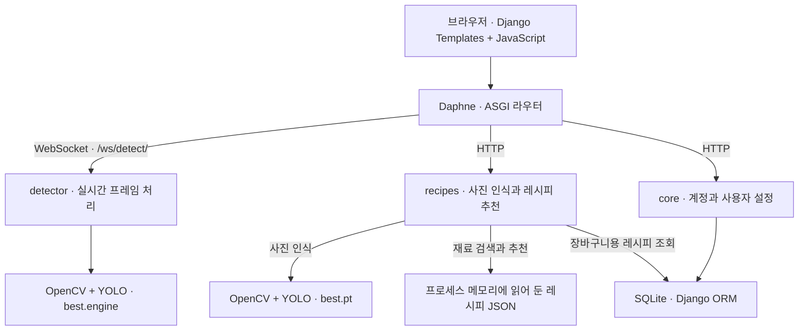

# SmartCook

**냉장고에 있는 재료로 오늘 만들 수 있는 요리를 찾는 웹 서비스**

양파와 감자를 카메라에 비추면 화면에 재료 이름이 표시됩니다. 사용할 재료를 선택하면 SmartCook이 보유 재료와 많이 겹치는 레시피부터 보여 줍니다. 요리를 시작한 뒤에는 “다음”이라고 말해 손을 쓰지 않고 다음 조리 단계를 들을 수 있습니다.

[프로젝트 코드](https://github.com/geonho27/smartCook_project) · [이건호의 기여](#이건호의-기여) · [전시 및 수상 기록](#전시-및-수상-기록)

<!-- 대표 영상 또는 GIF 위치. 카메라에 식재료가 잡히고 추천 레시피가 뜨는 구간. -->

## 세 가지 방법으로 재료 찾기

| 입력 방식 | 사용자가 보는 결과 |
| --- | --- |
| **실시간 카메라** | 영상 위에 재료 이름과 감지 영역이 표시됩니다. 인식된 재료 중 사용할 것만 골라 추천 결과를 확인합니다. |
| **사진 업로드** | 사진 한 장에서 여러 재료를 찾습니다. 감지 결과가 그려진 이미지와 재료 목록을 함께 보고 검색할 재료를 고릅니다. |
| **직접 입력** | 음식명이나 재료명으로 검색합니다. 보유 재료와 많이 겹치는 순서 또는 필요한 재료 수가 적은 순서로 결과를 살펴봅니다. |

레시피 상세 화면에서는 재료와 조리 순서를 확인합니다. 음성 안내를 켜면 “다음”, “이전” 명령으로 조리 단계를 이동할 수 있습니다. 추가로 살 재료는 레시피별 장바구니에 모아 볼 수 있습니다.

<!-- 기능 화면 위치. 실시간 인식 / 사진 업로드 / 추천 결과 / 조리 단계 화면. -->

## 사용 언어와 기술

| 영역 | 언어 · 기술 | SmartCook에서 맡은 일 |
| --- | --- | --- |
| 웹 화면 | HTML, CSS, JavaScript, Django Templates | 화면 렌더링, 카메라 입력, Canvas에 감지 영역 표시, 페이지 이동 없이 추천 목록 갱신 |
| 백엔드 | Python, Django 4.2, Django Channels, Daphne | 회원·레시피 요청 처리, 세션 관리, ASGI 기반 WebSocket 연결 |
| 식재료 인식 | Ultralytics YOLOv8, OpenCV | 사진과 카메라 프레임에서 식재료의 종류·위치·신뢰도 추출 |
| 데이터 | SQLite, Django ORM, JSON | 회원·레시피 모델 저장, 검색용 레시피 목록 로딩, 장바구니에서 레시피 조회 |
| 실시간 통신 | WebSocket, Redis | 브라우저와 서버 사이에서 프레임과 감지 결과를 교환. Redis는 Django Channels의 채널 레이어로 설정 |
| 음성 | Google Cloud Speech-to-Text / Text-to-Speech | 한국어 음성 명령을 인식하고 조리 단계를 음성으로 재생 |

## 백엔드 구조

카메라 화면은 서버와 두 방식으로 통신합니다. **영상 프레임과 감지 좌표**는 WebSocket으로 주고받고, **사용자가 확정한 재료와 추천 결과**는 HTTP로 주고받습니다. 카메라를 계속 비추는 동안에도 사용자는 원하는 시점에 재료를 선택해 검색할 수 있습니다.

| Django 모듈 | 책임 | 구현 위치 |
| --- | --- | --- |
| `core` | 회원가입·로그인, 재료 선호도와 음성 설정, 카메라·업로드 화면 진입 | [사용자 모델](smartcook_backend/core/models.py) · [화면 및 계정 처리](smartcook_backend/core/views.py) |
| `detector` | WebSocket 연결, 프레임 수신, 실시간 모델 추론과 결과 전송 | [WebSocket 라우팅](smartcook_backend/detector/routing.py) · [감지 처리](smartcook_backend/detector/consumers.py) |
| `recipes` | 사진 인식, 재료 검색과 추천, 레시피 상세, 장바구니, 음성 API | [HTTP 경로](smartcook_backend/recipes/urls.py) · [요청 처리](smartcook_backend/recipes/views.py) |

### 카메라에서 레시피까지

1. **프레임을 보냅니다.** 브라우저가 카메라 프레임을 JPEG로 인코딩해 `/ws/detect/`로 전송합니다. 서버는 대기열에 프레임을 하나만 둡니다. 추론 중 새 프레임이 들어오면 대기 중인 이전 프레임을 교체해 오래된 장면이 쌓이지 않게 합니다.
2. **인식 결과를 화면에 겹쳐 그립니다.** 서버는 추론을 별도 작업 스레드에서 수행하고 감지 좌표, 재료명, 신뢰도를 반환합니다. 브라우저는 좌표를 화면 크기에 맞춰 변환한 뒤 카메라 영상 위에 표시합니다.
3. **선택한 재료로 추천을 요청합니다.** 양파와 감자를 고르면 브라우저가 `GET /api/recipes/?q=양파&q=감자`를 호출합니다. 서버는 검색용 JSON에서 재료명을 정리해 비교하고, 하나 이상 일치하는 레시피를 기본적으로 **일치 개수가 많은 순서**로 반환합니다. 두 재료를 모두 쓰는 레시피가 한 가지만 쓰는 레시피보다 먼저 나옵니다.

[실시간 인식 서버](smartcook_backend/detector/consumers.py) · [카메라 화면과 추천 요청](smartcook_backend/smartcook_backend/templates/live.html) · [추천 API](smartcook_backend/recipes/views.py)

## 이건호의 기여

### 식재료 이미지 전처리

공개 데이터에서 한국 식재료 이미지를 충분히 확보하기 어려웠고, 웹에서 수집한 이미지로 학습한 모델은 실제 카메라에 비춘 재료를 다른 재료로 인식하곤 했습니다. 전시 환경에 맞는 데이터를 보완하기 위해 **식재료 100종을 선정해 직접 촬영**하고, 사진을 재료별로 분류한 뒤 이미지 속 식재료에 라벨을 달았습니다.

팀에서 사용한 데이터셋 v2는 사진의 EXIF 방향 정보에 맞춰 회전을 보정하고 이미지를 640 × 640픽셀로 통일했습니다. 각 식재료의 종류와 이미지 안에서의 위치는 COCO 형식으로 기록했습니다.

### 실시간 추천 연동과 반응형 화면

| 작업 | 구현 내용 |
| --- | --- |
| 실시간 인식과 추천 연동 | 라이브 화면에서 선택한 재료를 추천 API에 전달하고, 재료 일치 개수로 정렬한 결과를 같은 화면에 표시했습니다. [구현 커밋](https://github.com/geonho27/smartCook_project/commit/818974f139f662feeff354bc40e1e14d62dba747) |
| 모바일 카메라 전체화면 | 모바일에서 카메라 영역을 화면 전체로 확장하고 원래 레이아웃으로 돌아올 수 있도록 버튼과 스타일을 구현했습니다. [구현 커밋](https://github.com/geonho27/smartCook_project/commit/199646645f572fca15ebd0a57e5d83b4c513a2b4) |
| 로그인 화면 반응형 처리 | 화면 크기에 맞춰 로그인 화면의 배치와 요소 크기가 바뀌도록 CSS를 수정했습니다. [구현 커밋](https://github.com/geonho27/smartCook_project/commit/b18c68ed20861f3c57184053dbe4bb4f157903dd) |

<!-- 모바일 카메라 전체화면 적용 전후 비교 위치. -->

## 전시 및 수상 기록

한국전자전 현장에서 관람객에게 식재료를 카메라에 비추고, 인식된 재료로 레시피를 추천받는 과정을 시연했습니다.

| 행사 | SmartCook 팀 수상 결과 |
| --- | --- |
| 2025 한국전자전(KES) | 장려상 |
| 2025 스마트 DATA/AI 경진대회 | 우수상 |

<!-- 직접 보관한 SmartCook 전시 사진과 시연 영상 위치. -->

## 함께 만든 사람들

| 팀원 | 담당 |
| --- | --- |
| 최영우 | 프로젝트 총괄·기획, 추천 알고리즘 설계, 데이터 크롤링 |
| 이건호 | 식재료 데이터 전처리, 실시간 추천 연동, 반응형 디자인 |
| 경규민 | YOLO 모델 학습, 학습 데이터셋 설계 |
| 홍연화 | 인터페이스 디자인, Django API, UI/UX 구현 |
| 이유민 | 음성 인식·합성 기능, 웹 구조 구현, 서버 구축 |
